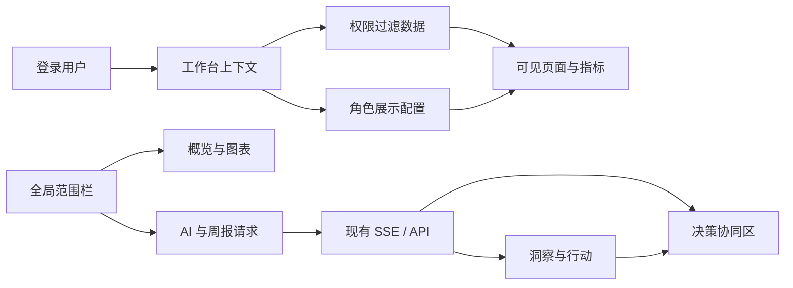

# LuminaX 产品级 UI 优化设计

**日期：** 2026-09-01  
**状态：** 已通过交互式设计评审，待书面确认  
**范围：** 工作台、登录页、管理后台、经营周报及共享设计系统  
**兼容要求：** 不改变现有业务逻辑、API、权限、指标口径、Agent 调度和数据源接口

## 1. 背景与目标

LuminaX 已具备统一工作台、角色模板、权限驱动、经营概览、洞察与行动、周报、AI 问答和模块化管理后台，但当前视觉体验仍存在以下问题：

- 信息层级偏平，页面主要依靠边框和卡片区分内容；
- 顶部范围筛选、经营数据和右侧助手像三个拼接区域；
- 品牌黄色出现频率较高，但没有稳定表达“关键动作”和“决策焦点”；
- 右侧区域仍具有普通 Chatbox 的观感，没有体现 AI 决策协同价值；
- 登录页、工作台、周报和管理后台尚未形成完整一致的产品语言；
- 角色模板能够改变内容，但没有充分改变信息优先级和默认阅读路径。

本次优化采用 **AI 决策协同型** 方向，将 LuminaX 塑造成专业经营中枢。目标不是增加业务功能，而是在完整兼容现有能力的前提下，提高管理层阅读效率、区域经理行动效率和产品演示完成度。

## 2. 已确认的产品决策

1. 覆盖全产品，而非只优化核心工作台；
2. 只优化明亮模式，深色只用于品牌头部、导航和局部决策焦点；
3. 允许视觉与布局重构，但保持业务逻辑和接口兼容；
4. 采用统一设计系统和角色化编排，不按页面独立换肤；
5. 角色模板可以改变信息优先级、默认页签和默认展开项，但不能扩大数据权限；
6. AI 助手升级为决策协同区，但不得复制“洞察与行动”的完整正文；
7. 不新增 UI 框架，不新增数据库表，不改变 API 契约。

## 3. 设计原则

### 3.1 专业经营中枢

界面首先服务经营判断与重复操作，不使用营销式大标题、装饰性渐变、浮动页面区块或大量嵌套卡片。重要内容通过排版、对齐、留白和语义色建立层级。

### 3.2 数据、洞察与行动闭环

工作台必须支持自然路径：

`选择经营范围 → 查看指标与趋势 → 发现异常 → 获取 AI 判断 → 查看证据 → 推进行动`

左侧负责完整数据、证据和正式洞察，右侧负责当前判断摘要、提问、追问和行动状态。两侧使用同一经营范围和同一分析结果。

### 3.3 品牌色克制使用

黄色只用于主命令、当前选择、AI 决策焦点和待执行行动的窄幅强调，不作为大面积页面背景，也不承担风险或正向状态语义。

### 3.4 角色自适应而非页面复制

所有角色共享组件和页面结构。角色模板通过展示配置调整默认信息顺序，不生成多套独立工作台，不在组件中直接判断用户名或角色名称。

### 3.5 稳定与可访问

控件尺寸、图表空间、加载状态和响应式布局必须稳定。正文对比度至少为 4.5:1，键盘焦点可见，交互控件在移动端至少为 44px，并尊重 `prefers-reduced-motion`。

## 4. 视觉系统

### 4.1 色彩令牌

| 语义 | 建议值 | 使用范围 |
| --- | --- | --- |
| 墨黑 | `#17181A` | 品牌头部、主要文字、选中页签、重要命令 |
| 品牌黄 | `#FFE600` | 主按钮、AI 焦点、当前状态、行动强调 |
| 画布灰 | `#F3F4F5` | 页面背景和区域间隔 |
| 面板白 | `#FFFFFF` | 数据面板、表格、表单和对话区域 |
| 数据蓝 | `#2563A6` | 中性数据主系列和信息状态 |
| 正向绿 | `#168354` | 达标、增长和成功状态 |
| 风险红 | `#C53B32` | 缺口、异常、危险和失败状态 |
| 边框灰 | `#D8DCE1` | 控件和区域分隔 |
| 次级文字 | `#676C75` | 范围、来源、辅助说明 |

图表可以使用受控的多色系列，但同一颜色在同一页面必须保持业务语义一致。不得只依赖颜色表达风险或选择状态。

### 4.2 排版层级

- 继续使用现有中文系统字体栈，减少额外字体加载和跨平台偏差；
- 关键经营数字使用 20–28px、较高字重和等宽数字特性；
- 页面标题使用 16–20px，紧凑面板标题使用 13–15px；
- 正文不低于 13px，主要业务阅读区建议 14px；
- 范围、来源、更新时间和图表辅助信息使用 11–12px；
- 字间距保持 0，不随视口宽度缩放字号。

### 4.3 形状、边界和阴影

- 卡片与工具面板圆角为 5–7px；
- 只对需要与画布区分的独立面板使用轻阴影；
- 页面章节不做浮动卡片，不在卡片中继续嵌套装饰性卡片；
- 筛选控件、按钮和表单使用统一高度、边框和焦点状态；
- 图标优先使用 Lucide，图标按钮提供可访问名称和 Tooltip。

### 4.4 动效

- 状态变化和面板切换使用 150–250ms 的轻量过渡；
- 动效只解释层级、状态或空间关系，不做持续装饰；
- 不通过动画改变稳定布局尺寸；
- 减少动态效果时直接显示最终状态。

## 5. 整体前端架构

### 5.1 设计令牌层

`src/app/globals.css` 维护全局语义令牌、字体、基础状态和 Markdown 规则。业务组件不继续散落重复的原始十六进制颜色；确有页面专属语义时使用清晰命名的局部变量。

### 5.2 产品外壳层

工作台、登录页和管理后台共享品牌头部、页面画布、按钮、反馈、焦点和状态规范。页面可以有不同布局，但不得呈现为不同产品。

### 5.3 角色展示层

角色模板输出纯展示配置，例如：

```ts
interface WorkbenchPresentationProfile {
  defaultView: "overview" | "analysis" | "report";
  overviewSectionOrder: string[];
  assistantMode: "summary_first" | "action_first" | "finance_first";
  defaultExpandedSections: string[];
}
```

展示配置只能使用服务端已返回的权限过滤结果。权限不足的模块、指标或门店不能因模板配置重新出现。

### 5.4 业务组件层

经营概览、洞察、证据、行动、周报、助手和后台能力域继续保持独立组件边界。不得将本次视觉调整合并成新的超大页面组件。

## 6. 核心工作台设计

### 6.1 桌面布局

- 顶部使用深色品牌头部和黄色底部细线；
- 范围栏置于品牌头部下方，集中管理门店、日期、对比门店和可用指标；
- 主体默认使用约 68% 数据区和 32% 决策协同区；
- 决策协同区可收起，但收起不得中断流式回答、洞察生成或行动保存；
- 数据区继续保留“经营概览 / 洞察与行动 / 经营周报”三视图。

### 6.2 页面职责

| 区域 | 主要问题 | 内容 |
| --- | --- | --- |
| 经营概览 | 当前经营表现如何 | KPI、趋势、渠道、品类、时段和退款监控 |
| 洞察与行动 | 哪里有问题，证据和下一步是什么 | 核心判断、关键发现、支持证据、待核查项和行动清单 |
| 经营周报 | 如何形成周期性正式汇报 | 周期总结、关注事项、指标表、图表和导出 |
| 决策协同区 | 接下来要分析或推进什么 | 快捷提问、判断摘要、后续追问、行动进度和输入框 |

决策协同区不展示洞察页的完整发现和证据，也不将完整 Chatbox 正文裁剪成残缺摘要。它展示由结构化洞察生成的稳定判断摘要，并提供进入正式洞察的明确命令。

### 6.3 范围一致性

范围栏仍是门店、日期和对比范围的唯一客户端来源。图表、周报、AI 请求和范围说明消费同一规范化状态。历史洞察保留生成时范围，当前范围不一致时继续提供“切换到洞察范围”。

### 6.4 角色编排

- **CEO / COO：** 核心判断、风险与机会、关键指标、行动进度、支持证据；
- **CFO：** 销售目标、退款风险、促销贡献、财务口径和支持证据；
- **区域经理：** 异常门店、门店排序、归因证据、行动清单和经营趋势；
- **系统管理员：** 系统状态、配置任务、权限风险和最近变更。

角色模板只改变默认顺序和展开状态。用户仍可进入权限允许的其他视图。

## 7. 其他页面设计

### 7.1 登录页

- 第一屏直接提供登录工具，不增加营销落地页；
- 使用深色品牌头部、明亮画布和单一登录区域；
- 用户名和密码使用可见标签，密码显示按钮使用图标和可访问名称；
- 登录失败在对应表单附近展示，不清空用户名；
- 提交中禁用重复提交并提供明确加载反馈；
- 保留现有限流、会话和 `next` 跳转行为。

### 7.2 管理后台

- 使用深色模块导航和明亮内容区；
- 指标、权限、报表、数据源和 Agent 配置保持独立能力域入口；
- 数据列表优先使用表格，模式选择使用分段控件，复杂编辑使用抽屉或对话框；
- 不用大量重复卡片表示导航或表单字段；
- 保存状态必须区分未修改、保存中、成功和失败；
- 删除、撤销发布、权限收缩等危险操作使用二次确认；
- 不改变后台现有路由和服务端授权边界。

### 7.3 经营周报

- 在工作台内使用正式阅读布局，不复制经营概览仪表盘；
- 顶部集中展示报告周期、门店范围、生成状态和导出命令；
- 经营趋势总结、需关注信息、指标表和图表使用稳定章节层级；
- AI 生成失败时静默回退到确定性内容，并提供轻量状态说明；
- 保留现有 HTML、安全转义、权限和数据范围契约。

## 8. 移动端设计

- 继续使用“经营数据 / 决策协同”分段切换，不将桌面双栏压缩为窄屏双栏；
- 范围栏在移动端显示范围摘要，编辑使用适合窄屏的抽屉或分组面板；
- 决策协同面板优先展示核心判断、行动和输入框；
- 长图表、证据和周报正文在经营数据面板单列展示；
- 固定格式图表使用明确的纵横比和最小高度；
- 页面不得出现非预期横向滚动、文本遮挡和控件重叠。

## 9. 交互与状态

### 9.1 加载与刷新

- 初次加载使用与真实内容尺寸一致的骨架屏；
- 局部刷新保留旧内容并显示局部进度，不清空整页；
- 生成或保存期间稳定保留布局尺寸，避免累计布局偏移。

### 9.2 无数据与权限

- 无数据状态说明当前范围没有数据，并提供修改范围的命令；
- 权限不足时明确说明内容不可访问，不展示裁剪后可能失真的图表或洞察；
- 登录失效后清除受保护内容并进入登录流程。

### 9.3 AI 状态

- AI 处理中展示当前阶段，不伪造百分比进度；
- 洞察更新成功后，决策协同区更新判断摘要并允许进入正式洞察；
- AI 或洞察失败时保留完整降级回答和上一份有效洞察；
- 不因 UI 切换、面板折叠或移动端切换中断请求；
- 同一用户并发请求继续遵守现有最新请求保护。

### 9.4 操作反馈

- 保存、勾选和轻量命令使用控件附近状态或短时通知；
- 失败反馈说明可恢复动作，不暴露服务端内部错误；
- 只有危险操作和不可逆操作使用阻断式确认。

## 10. 数据与交互流



约束如下：

1. 权限过滤先于展示配置；
2. 角色模板不能扩大表、字段或门店值权限；
3. 范围栏是新请求的唯一客户端范围来源；
4. AI 协同区和洞察页消费同一结构化结果，但承担不同展示职责；
5. 本次不新增数据存储，不更改现有 API 和 SSE 事件；
6. 指标数值、图表数据和周报口径继续来源于现有固定 SQL 与计算模块。

## 11. 组件改造边界

重点改造现有组件及其直接依赖：

- `src/app/globals.css`：语义令牌和基础排版；
- `src/components/luminax/workbench/WorkbenchShell.tsx`：桌面与移动外壳；
- `WorkbenchHeader.tsx`：品牌和用户命令；
- `ScopeBar.tsx`：范围编辑和移动摘要；
- `OverviewPanel.tsx`：KPI 和图表信息层级；
- `AssistantPanel.tsx`：决策协同呈现；
- `InsightCanvas.tsx` 及洞察子组件：正式阅读和状态统一；
- `ReportView.tsx`：周报阅读与命令区；
- 登录页和 `LoginForm.tsx`：登录体验；
- 管理后台外壳和现有能力域页面：导航、表格、表单与反馈。

允许提取可复用的产品级展示组件，但只在减少真实重复或建立稳定交互契约时新增抽象。不得将业务逻辑移动到纯展示组件。

## 12. 实施顺序

1. 建立设计令牌、基础状态组件和图表主题；
2. 优化登录页与共享产品外壳；
3. 重构工作台、范围栏、经营概览和决策协同区；
4. 统一洞察、行动和周报阅读体验；
5. 统一管理后台导航、表格、表单和状态；
6. 接入角色展示配置；
7. 完成移动端、可访问性和生产回归。

每个阶段必须保持本地可运行，不允许先破坏现有页面再等待后续阶段恢复。

## 13. 测试策略

### 13.1 自动化验证

- TypeScript 类型检查；
- ESLint 源码检查；
- 现有业务与接口测试；
- 角色展示配置的确定性和权限交集测试；
- 关键状态组件和工作台视图测试；
- Next.js 生产构建。

### 13.2 浏览器回归

- 桌面端：`1440×900`、`1280×720`、`1024×768`；
- 移动端：`390×844`；
- 验证登录、范围筛选、三个经营视图、AI 问答、洞察更新、行动勾选、周报和后台关键路径；
- 验证无重叠、非预期横向滚动、文字截断和空白图表；
- 验证键盘操作、可见焦点、Tooltip 和对比度；
- 对关键页面保留改造前后截图用于视觉对比。

### 13.3 数据与安全回归

- UI 改造前后同一范围的指标值和图表数据一致；
- AI、洞察和周报协议不变；
- 角色配置不能扩大权限；
- 错误信息不泄漏内部异常、凭据、Prompt 或权限策略。

## 14. 非目标

本次不包含：

- 新业务模块或新指标；
- Agent Prompt、模型、记忆或调度逻辑调整；
- 数据库结构、固定 SQL 或指标计算口径调整；
- 新的深色主题；
- 自定义仪表盘拖拽编排；
- 历史洞察、多人任务协作或通知系统；
- 管理后台路由体系重写；
- 新 UI 框架或重型动效库。

## 15. 验收标准

1. 工作台、登录页、管理后台和周报呈现为同一产品；
2. AI 决策协同区与正式洞察职责清晰，不重复或截断完整分析；
3. CEO/COO、CFO、区域经理和管理员模板具有不同默认信息优先级；
4. 角色模板不扩大现有权限；
5. 黄色只用于关键动作和决策焦点，风险和正向状态语义稳定；
6. 经营数据、指标口径、API、SSE 和 Agent 行为保持兼容；
7. 桌面和移动目标尺寸无重叠、非预期滚动和不可读图表；
8. 加载、无数据、权限不足、AI 失败和保存失败状态完整；
9. 键盘、焦点、触控尺寸和文字对比度满足本设计要求；
10. 类型检查、Lint、测试、生产构建和浏览器关键路径回归通过。
